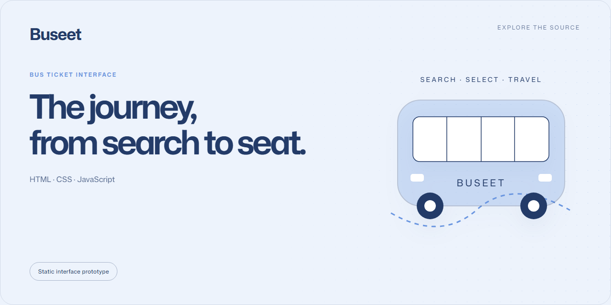

# Buseet

A static prototype of a bus-ticket booking journey, from schedule selection to passenger and payment screens.

**HTML · CSS · JavaScript** · Static interface prototype

## Screens

- Schedule and ticket selection.
- Passenger details and payment-method layouts.
- Sign-in, registration and profile screens.

## Open locally

Clone the repository and open [index.html](index.html) in your browser. There is
no package installation or build step.

For a local HTTP server, run this from the repository root:

```sh
python -m http.server 8080 --bind 127.0.0.1
```

Then open **http://127.0.0.1:8080**.

## Source map

| Path | Purpose |
| :-- | :-- |
| [src/public/](src/public/) | Booking-flow screens |
| [src/js/](src/js/) | Browser interactions |
| [src/style/](src/style/) | Styles |
| [src/assets/](src/assets/) | Existing icons and media |

## Prototype boundary

Authentication, payment processing and booking persistence are not production
services. Use fictional passenger details. Existing third-party logos and media
retain their respective ownership. See [SECURITY.md](SECURITY.md).
